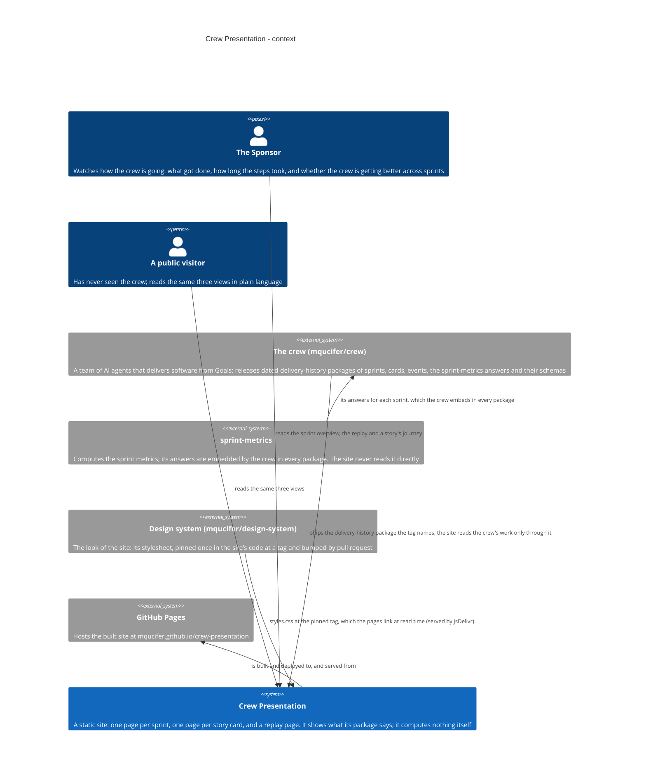
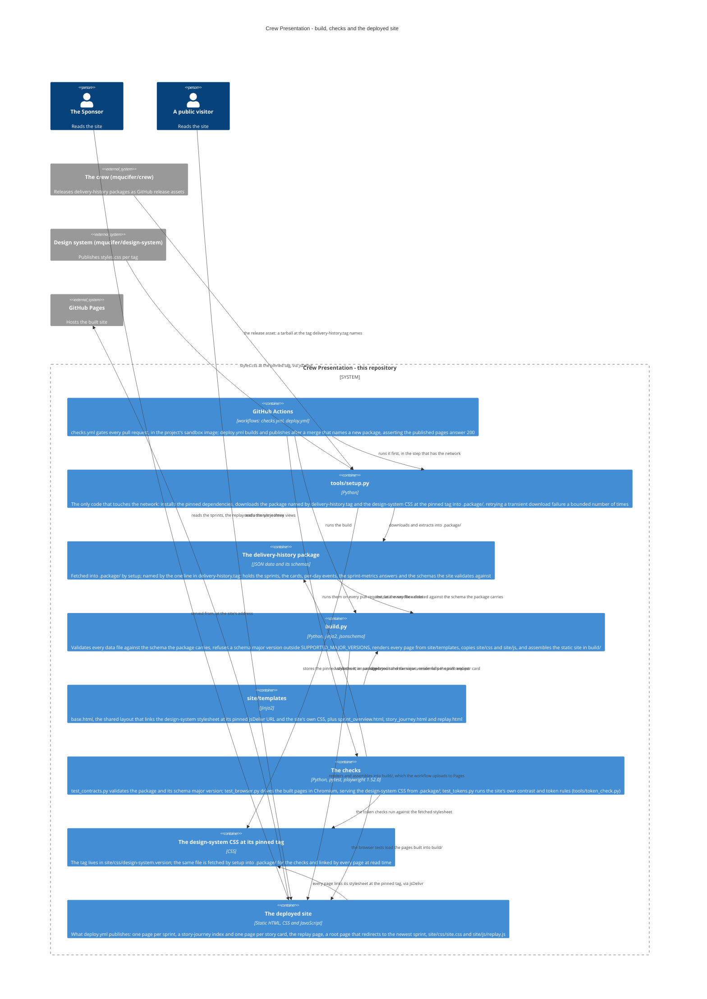
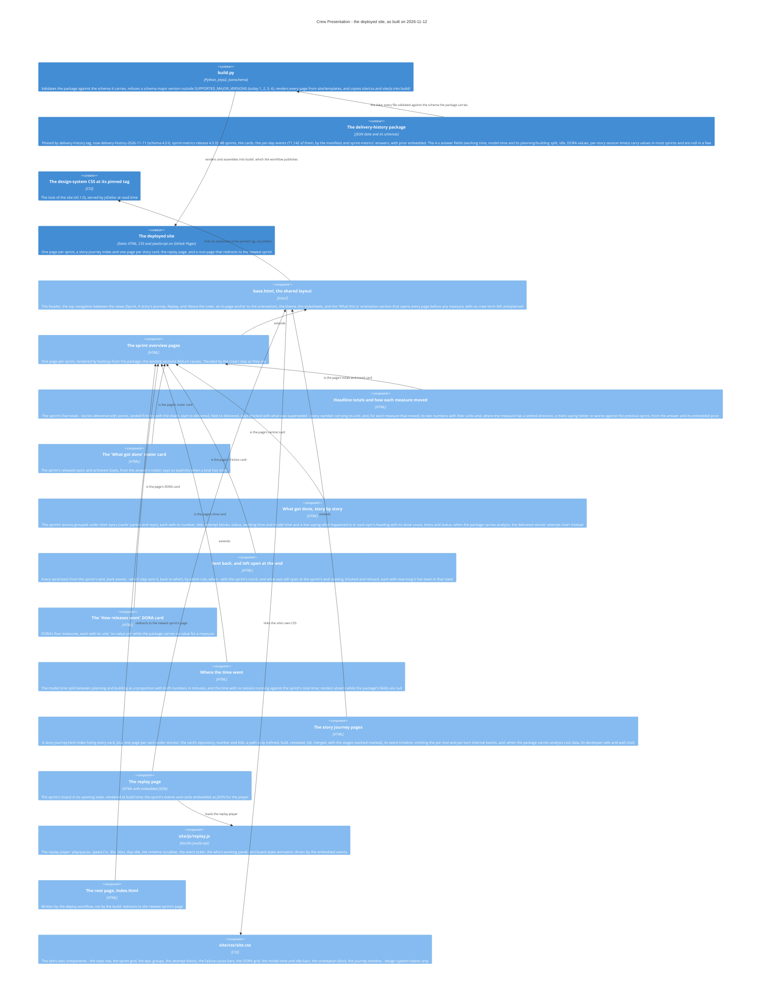

# crew-presentation - architecture

The system as it is in the code, on 2026-11-12.

Crew Presentation is a static site on GitHub Pages that shows how the crew
works: one page per sprint, one page per story card behind an index of every
card, and a replay page for a sprint's events. There is no server and no
backend. All of the data it shows arrives as a **delivery-history package**
the crew releases; the site validates it against the schema the package
itself carries, renders the pages, and is published to Pages when a merge
names a new package. The repository keeps no copy of the crew's data or of
any schema, and the site shows what its package says - it computes no metric
itself.

## Context

The site serves two readers. Its only data source is the crew: the package
the one line in `delivery-history.tag` names, shipped as a release asset and
updated by the crew opening a pull request that changes that line.
sprint-metrics is upstream of the crew (its answers ride inside every
package); the site never reads it directly.

## Containers

The build side lives in this repository; the product is the static site it
publishes. `tools/setup.py` is the only code that touches the network. The
pre-merge gate is `checks.yml`, which runs the checks in the sandbox - the
package's schema major version is refused there, so a package the site cannot
display never reaches a deploy. `deploy.yml` fires after a merge that changes
`delivery-history.tag`: it checks out the latest release tag of the site's
code, points the build at the package the merge named, and publishes to
Pages.

## The deployed site, in detail

The three views all extend one shared layout, which opens every page with
the "What this is" orientation, before any measure. The build renders the
opening state of the board into the replay page and embeds the sprint's
events and cards as JSON for the player.

## How it is built and deployed

- `delivery-history.tag` is the one line that names the package. The crew
  releases a new package and opens a pull request here that changes that
  line; the repository keeps no copy of the data or of any schema.
- `checks.yml` runs the setup and then the checks the project record names -
  `test_contracts.py`, the build, `test_browser.py` and `test_tokens.py` -
  in the project's sandbox image. The pre-merge gate on the package is
  `test_contracts.py` and `build.py`'s `SUPPORTED_MAJOR_VERSIONS`: a package
  on a schema major version the site cannot display fails its pull request,
  so the site never sees it.
- `deploy.yml` runs only on `main`, after a merge that changed
  `delivery-history.tag`. It checks out the latest release tag of the site's
  code, overwrites the tag file with the merged one, runs setup and the
  build, writes a root page that redirects to the newest sprint, uploads
  `build/`, deploys to Pages, and asserts the root and the named pages
  answer 200.
- The design system is pinned once, in `site/css/design-system.version`, and
  bumped by pull request. It reaches the site two ways: the browser links
  `styles.css` at that tag via jsDelivr at read time, and setup fetches the
  same file into `.package/` so the token and browser checks run without a
  network.
- `board.yml` also lives in this repository but is not part of the site's
  pipeline: it moves the cards this repository's own board holds that no
  crew role moves, which the crew's recorded events - and so the site - see.

## Where the build differs from the target

The diagram above starts from the Goal's target diagram and is corrected to
what the code shows on 2026-11-12. The code differs from the target in these
places:

- **The pinned package.** The target names `delivery-history-2026-11-04`
  (schema 3.0.0, sprint-metrics 4.2.1, 41 sprints, 58,170 events). The code's
  `delivery-history.tag` pins `delivery-history-2026-11-11` instead: schema
  4.0.0, sprint-metrics release 4.5.0, 48 sprints, and 71,142 events by the
  manifest.
- **The version gate.** The target says the gate refuses a schema major
  version outside 1, 2, 3. The code's `SUPPORTED_MAJOR_VERSIONS` is
  `(1, 2, 3, 4)` in both `build.py` and `test_contracts.py`; a 4.0.0 package
  passes the gate, which is how the pinned package builds.
- **The 4.x answer fields.** The target records them as null or empty in
  every sprint, which was true of the package it named. In the pinned
  `delivery-history-2026-11-11` package they carry values in most sprints
  (working time, model time and its planning/building split, idle, DORA,
  per-story session times), and are null in a few. `prior` is null for seven
  of the 48 sprints, and the package carries no `analysis` section, so the
  build takes its fallback paths: the epic-grouped story list from the
  cards, "What changed" from the answer's embedded prior, and "Decided by
  the crew" from events and cards.
- **The orientation block.** The target draws "What this is" as its own
  element that "opens the sprint page before any measure". The build has it
  as a section of `base.html`, the shared layout: it opens every page
  (sprint, journey and replay) before any measure, and the navigation's
  "About the crew" item is an in-page anchor to that section, not a separate
  view. The diagram folds it into the shared layout rather than carrying it
  as a separate component.
- **Two sprint-page cards the target's component list omits.** The "What got
  done" roster card (the sprint's released epics and achieved Goals, from the
  answer's roster) and the "How releases went" DORA card (DORA's four
  measures, "no value yet" while the package carries no value for a
  measure). Both predate the Goal; the diagram adds them as components.
- **"What changed" lines.** The target says a line for each measure against
  the previous sprint. The build gives a line only to a measure that moved
  (one equal to its prior, or null on either side, gets none), and the
  better/worse mark appears only where a measure has a settled direction -
  the six headline measures; "Stories superseded" shows its two numbers
  without a direction word.
- **The journey pages carry more than the event timeline.** The target names
  only "the card's repository, number and title and its event timeline".
  Each card page also carries a path strip (refined, built, reviewed, QA,
  merged, with the stages reached marked) and a "What it cost" block
  (developer calls, wall clock) when the package carries analysis cost data,
  and the timeline omits the per-tool and per-turn internal events. The view
  also has an index page, `story-journey.html` (the navigation's "A story's
  journey"), listing every card; the per-card pages live under `stories/`.
- **The target's diagram omits the replay player.** The build ships
  `site/js/replay.js`, which the replay page loads and which drives
  play/pause, the speed control, skip-idle, the timeline scrubber, the event
  ticker, the who's-working panel and the board animation.

The boards in `docs/design/mock/` are the design reference to build to; they
are not part of the system.
