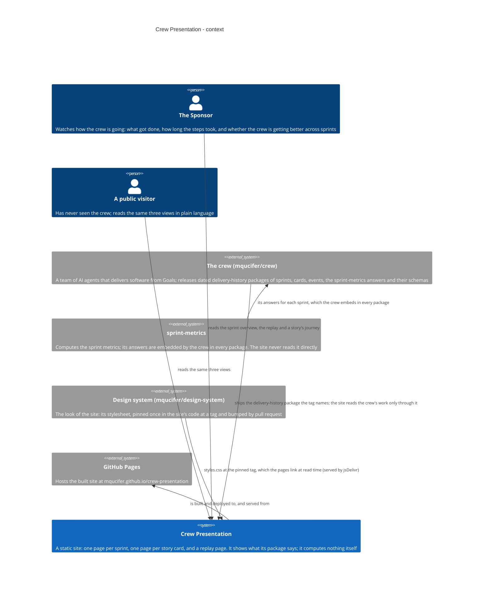
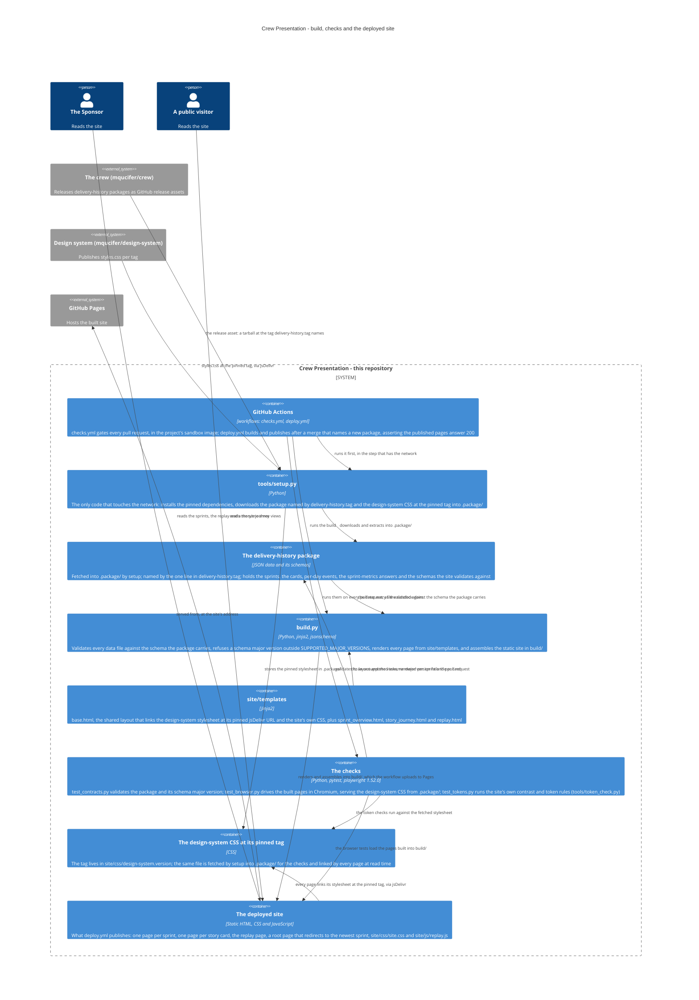
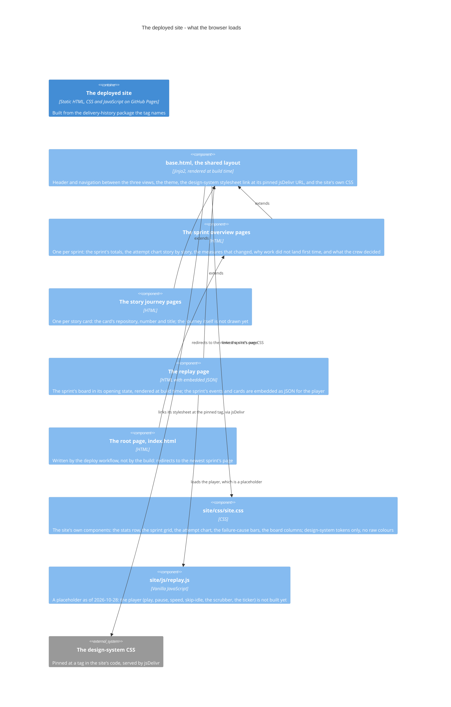

# crew-presentation - architecture

The system as it is in the code, on 2026-10-28.

Crew Presentation is a static site on GitHub Pages that shows how the crew
works: one page per sprint, one page per story card, and a page for a
sprint's events. There is no server and no backend. All of the data it shows
arrives as a **delivery-history package** the crew releases; the site
validates it against the schema the package itself carries, renders the
pages, and is published to Pages when a merge names a new package. The
repository keeps no copy of the crew's data or of any schema, and the site
shows what its package says - it computes no metric itself.

## Context

The site serves two readers. Its only data source is the crew: the package
the one line in `delivery-history.tag` names, shipped as a release asset and
updated by the crew opening a pull request that changes that line.
sprint-metrics is upstream of the crew (its answers ride inside every
package); the site never reads it directly.

## Containers

The build side lives in this repository; the product is the static site it
publishes. `tools/setup.py` is the only code that touches the network. The
pre-merge gate is `checks.yml`, which runs the checks in the sandbox - the
package's schema major version is refused there, so a package the site cannot
display never reaches a deploy. `deploy.yml` fires after a merge that changes
`delivery-history.tag`: it checks out the latest release tag of the site's
code, points the build at the package the merge named, and publishes to
Pages.

## The deployed site, in detail

The three views all extend one shared layout. The build renders the opening
state of the board into the replay page and embeds the sprint's events and
cards as JSON; the player that would animate them is not built yet.

## How it is built and deployed

- `delivery-history.tag` is the one line that names the package. The crew
  releases a new package and opens a pull request here that changes that
  line; the repository keeps no copy of the data or of any schema.
- `checks.yml` runs `tools/setup.py` and then the three checks in the
  project's sandbox image. The pre-merge gate on the package is
  `test_contracts.py` and `build.py`'s `SUPPORTED_MAJOR_VERSIONS`: a package
  on a schema major version the site cannot display fails its pull request,
  so the site never sees it.
- `deploy.yml` runs only on `main`, after a merge that changed
  `delivery-history.tag`. It checks out the latest release tag of the site's
  code, overwrites the tag file with the merged one, runs setup and the
  build, writes a root page that redirects to the newest sprint, uploads
  `build/`, deploys to Pages, and asserts the root and the named pages
  answer 200.
- The design system is pinned once, in `site/css/design-system.version`, and
  bumped by pull request. It reaches the site two ways: the browser links
  `styles.css` at that tag via jsDelivr at read time, and setup fetches the
  same file into `.package/` so the token and browser checks run without a
  network.
- `board.yml` also lives in this repository but is not part of the site's
  pipeline: it moves the cards this repository's own board holds that no
  crew role moves, which the crew's recorded events - and so the site - see.

## delivery-history 2.0.0 (announced 2026-10-29)

The crew announced `delivery-history` 2.0.0 on 2026-10-29: it replaces 1.x on
2026-11-06, whether this project has moved to it or not. This project pins
`delivery-history-2026-10-29`, schema 1.11.0, in `delivery-history.tag`. The
ruling below is against the crew's announced changelog for 2.0.0; the 2.0.0
schemas and mock are not in this repository and the site has no network, so
the field-shape rulings rest on that changelog, while the version-gate
refusal is verifiable from this repository's own code.

**The version gate now accepts schema major 2.** `SUPPORTED_MAJOR_VERSIONS` is
`(1, 2)` in `build.py`, and it keeps its own copy in `test_contracts.py`.
`_check_schema_version` in `build.py` exits non-zero when the manifest's
`schema_version` major is not in that set, and `test_contracts.py` carries the
same gate. The contract tests pin the refusal: both
`test_build_fails_on_unsupported_major_version` and
`test_unsupported_major_version_fails_with_version` feed `schema_version`
`"3.0.0"` and assert the build and the check fail, naming major 3. A 2.0.0
package (schema major 2) passes the pre-merge gate; its fields are then
validated against the schema the package carries.

**What build.py must change to adopt 2.0.0:**

- Support schema major 2: add `2` to `SUPPORTED_MAJOR_VERSIONS` in `build.py`
  and mirror it in `test_contracts.py`.
- Read `top_failure_causes` in its new shape. 1.x carries it as a map of
  cause-code to count (for example `{"EDIT": 1, "VERIFY": 1}`); 2.0.0
  reshapes it to a list of `{class, role, count}`, the same list-of-objects
  shape `failure_breakdown` already uses in 1.x. `_normalize_failure_causes`
  in `build.py` reads the 1.x map via `items()` and reads list items by
  `item.get("reason", item.get("cause", ""))` and `item.get("count", 0)`.
  The 2.0.0 entries carry `class`, `role` and `count`, not `reason` or
  `cause`, so `_normalize_failure_causes` would emit an empty reason for
  every entry and `_build_failure_causes` would render each as "Cause not
  recorded". It must read the `{class, role, count}` fields instead;
  `CAUSE_LABELS`, which maps the old reason codes to display strings, no
  longer applies.
- Stop reading the removed escalation fields. 2.0.0 removes
  `escalation_count` and `escalation_rate_percent` from each answer and its
  `prior`, `delta` and `flags`, and drops `escalation_count` as a measure from
  the "what changed" list. `build.py` surfaces `escalation_count` in two
  places that must stop reading it: the sprint stat
  (`metrics.get("escalation_count")` in `_render_pages`, rendered as the
  "escalations" stat in `site/templates/sprint_overview.html`) and the
  `_changed_label` map (`"escalation_count": "escalations"`).
  `escalation_rate_percent` is not surfaced by `build.py` today; it leaves the
  contract with the rest.

**What the site loses by staying on 1.11.0.** 1.11.0 carries
sprint-metrics 1.3.1's answers; 2.0.0 carries 4.2.1's. A site that keeps its
pin on 1.11.0 and does not adopt 2.0.0 does not display the 4.x measures the
contract adds: the costs, rework, roster, working and idle time, and DORA
measures. The crew's own escalation record is untouched by this: the
`escalated` events and pattern, and each story's `escalations`, stay. Only
sprint-metrics' `escalation_count` and `escalation_rate_percent` leave.

## What is not there yet

As of 2026-10-28 the code does not yet have:

- The replay player. `site/js/replay.js` is a placeholder; the replay page
  shows the board's opening state, rendered at build time, with the
  sprint's events and cards embedded as JSON for the player.
- The story's journey. The journey pages carry only the card's repository,
  number and title.
- The timeline, event-ticker and who's-working sections on the replay
  page: they are empty containers, awaiting the player.

The boards in `docs/design/mock/` are the design reference to build to; they
are not part of the system.
