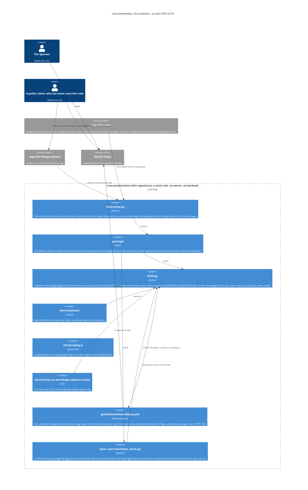
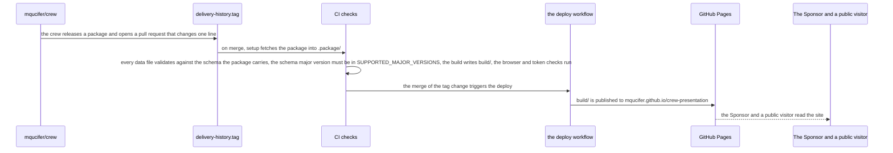

# Architecture

The system as built, as of 2026-10-25, when Goal #101's epics merged. This
document is drawn from the code: where the code and the onboarding record's
design description disagree, the code wins, and the differences are listed at
the end.

## The system, as C4

A static site that shows how the crew works: one page per sprint, one page per
story card, a replay of the latest sprint, and the "A story's journey" view.
It reads the crew's `delivery-history` package (which already carries
sprint-metrics' answers), never computes metrics itself, and holds no copy of
the crew's data or schemas — each package brings its own. The look comes from
`mqucifer/design-system`, pinned by tag and served from jsDelivr.

## How a release reaches the visitor

A package on any other schema major version fails the pull request that brought
it, so the site never renders data it cannot display. Each package carries
everything up to its date, so a trend reaches back as far as the crew's
history.

## The containers, as the code has them

- **`build.py`** — the build entry point. Reads the package from
  `.package/{tag}/` (the tag from `delivery-history.tag`), validates
  `manifest.json` against `manifest.schema.json`, `delivery-history.json`
  against `schema.json`, and each `events/*.json` against
  `events.schema.json` (jsonschema, Draft 2020-12), then checks the manifest's
  `schema_version` major against `SUPPORTED_MAJOR_VERSIONS = (1,)` (the current
  package is 1.11.0). Renders the pages with Jinja2, copies `site/css/` and
  `site/js/`, and writes the assembled site to `build/`. It normalizes and
  displays sprint-metrics' answers — for instance coercing
  `top_failure_causes` across the shapes it has seen, and mapping cause codes
  to words — but never computes a metric.
- **`site/templates/`** — `base.html` (theme bootstrap, the pinned
  design-system stylesheet at its jsDelivr URL, the site's own CSS, and the
  views navigation: Sprint / A story's journey / Replay), plus one template per
  view: `sprint_overview.html`, `replay.html`, `story_journey.html`.
- **`site/js/replay.js`** — a `crew:placeholder` stub with an empty `init()`.
  The replay page loads it, but the player's play/pause, speed, skip-idle,
  scrubber and ticker behaviour is not implemented. What the page carries
  instead, server-rendered: the latest sprint's board (columns derived from
  its events in the design system's tone order, each card in its earliest
  `from_column`, linked to its GitHub issue) and the sprint's events and card
  metadata embedded as a `#replay-data` JSON script.
- **`site/css/`** — `site.css`, the site's own CSS, every colour a
  design-system token; and `design-system.version`, one line (`v0.1.0`), the
  pinned design-system tag read by `tools/setup.py` and referenced in
  `base.html`.
- **`tools/setup.py`** — the only code that touches the network. Installs `uv`
  via pip if the image lacks it, runs `uv lock`, exports the lockfile with
  `uv export --frozen --extra dev --no-emit-project`, and installs with
  `pip install --user --require-hashes --no-deps` (the checks run the image's
  bare `python`, which does not see a virtual environment). Then it downloads
  the delivery-history release asset the tag names from the crew's releases
  into `.package/{tag}/`, and the design-system `styles.css` at the pinned tag
  from jsDelivr into `.package/design-system-{version}.css`.
- **`tests/` and `tools/token_check.py`** — the four checks CI runs:
  `test_contracts.py` (every package data file against the schema the package
  carries; an unsupported major version or a non-conforming file fails with the
  version or the file named), `build.py` itself, `test_browser.py` (132 tests:
  Playwright page loads from `build/` with the design-system CSS served from
  `.package/` via route interception, both themes, phone width at 375px, the
  sprint and views navigation, the attempt chart, the trend card, the
  failure-cause labels, the story slugs, and the replay's server-rendered
  board and embedded JSON), and `test_tokens.py` (via `tools/token_check.py`:
  no raw colour literal outside a token block in `site.css`, and every
  text-on-background token pair meets WCAG 4.5:1 in both the light and dark
  themes). `ruff format --check` is the autofix check.
- **`.github/workflows/deploy.yml`** — as recorded in `.crew/project.yaml`: a
  merged change to `delivery-history.tag` builds the site from its latest
  release tag (the tag applied when an epic completes) with the package the tag
  names, deploys the output to GitHub Pages, then asserts the site root and
  each page return HTTP 200.

## The pages the build writes

- **One per sprint**, `{sprint-slug}.html` (name lowercased, spaces to
  hyphens): a navigation strip between the sprints, the stat row (stories
  delivered, landed first try, escalations, cycle time in hours and minutes,
  points delivered), the "What changed" trend card, the attempt chart (each
  story's blocks, each row linking to that story's journey page), the "Why
  work didn't land first time" cause bar chart, and "Decided by the crew". A
  sprint with no key in `sprint_metrics.answers` is skipped with a note.
- **One per card** in the package's `cards` array, at
  `stories/{repo with slashes as hyphens}-{number}.html`, from the
  `story_journey.html` template (today a header card with the repo, number and
  title).
- **`replay.html`**: the latest sprint's name and dates as the header, the
  board and the `#replay-data` JSON described above, with empty "Timeline" and
  "Who's working" sections.
- **`story-journey.html`**: the "A story's journey" view page.
- Plus copies of `css/site.css` and `js/replay.js`.

## Where the build differs from the target

Goal #101 has no target diagram (its look came before ADR 0036), so there is no
target this build could differ from; the diagram above is drawn from the code.
For the record, the code differs from the onboarding record's design
description in four ways:

1. **The replay player is not built.** The design describes
   `site/js/replay.js` as the player (play/pause toggle, speed control,
   skip-idle, timeline scrubber, event ticker, board-state rendering), and its
   `test_browser.py` as exercising the player. The file is still a
   `crew:placeholder` stub, and the browser tests cover the server-rendered
   board and embedded JSON the player will consume, not the player's
   interactions.
2. **How setup installs the Python dependencies.** The design says "runs
   `uv sync` to install Python dependencies from `uv.lock`"; the code runs
   `uv lock`, then `uv export --frozen --extra dev --no-emit-project`, then
   `pip install --user --require-hashes --no-deps`, because the checks run the
   image's own `python`, which does not see a virtual environment. Same
   outcome, different mechanism.
3. **More pages than the three named views.** The design lists one template
   per view plus `base.html`; the build additionally renders one page per card
   under `stories/`, linked from each sprint's attempt chart.
4. **A font dependency the design does not name.** `base.html` also links
   Google Fonts (Fraunces, Public Sans); the design records only the
   design-system CSS as the external stylesheet.
